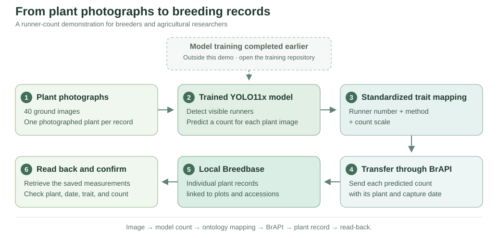
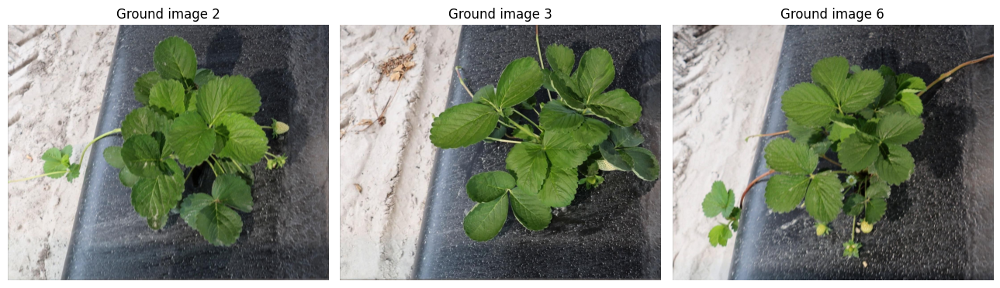
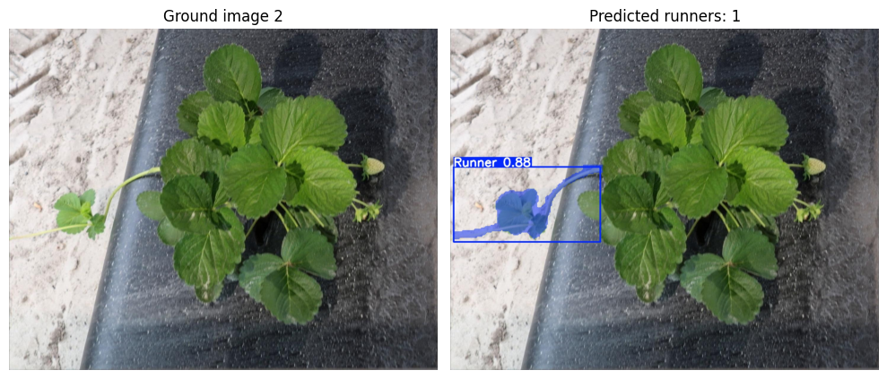
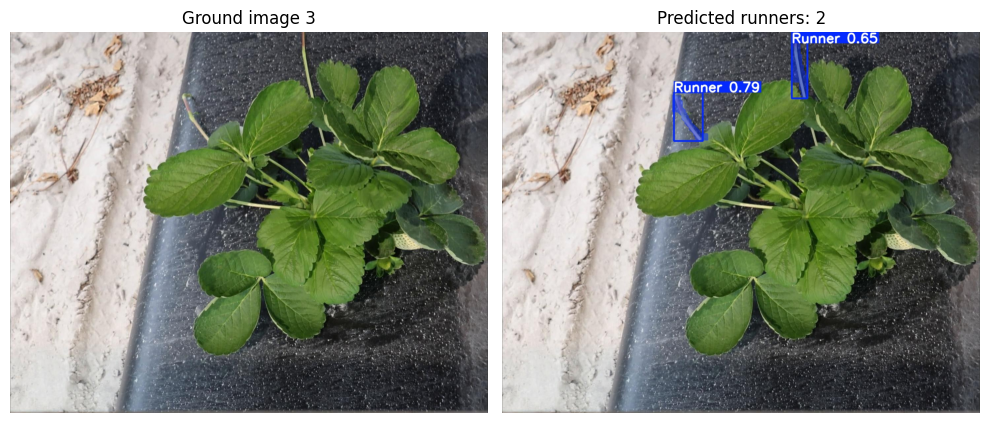
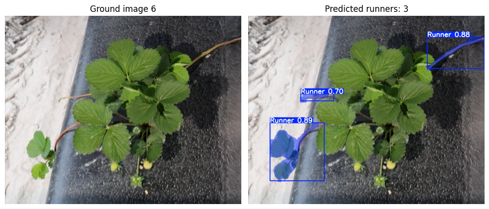

# From strawberry photographs to breeding records

Manual trait measurement is labor-intensive, time-consuming, and can be inconsistent. This demonstration turns plant images into traceable breeding observations. Crop Ontology defines each observation variable through **trait, method, and scale**—what is measured, how, and how the result is expressed. BrAPI provides a shared interface for transferring these records between breeding databases and data-collection or analysis tools.

**Plant image → predicted runner count → standardized ontology mapping → BrAPI → local Breedbase.**

**Model training has already been completed.** The training workflow and reproduction results are available in [strawberry-runner-repro](https://github.com/Bidhan-ghimire/strawberry-runner-repro).

## 1. Meet the plants

For this demonstration, **40 ground images (GI)** were selected from the research dataset of [Zhou et al. (2025)](https://doi.org/10.1016/j.atech.2025.101290), downloaded from [Dryad](https://doi.org/10.5061/dryad.bzkh189nw). The plants were grown at the strawberry farm at the University of Florida Gulf Coast Research and Education Center (UF GCREC), Wimauma, Florida, as part of strawberry breeding trials.

## 2. Count strawberry runners

The trained YOLO11x segmentation model detects runner instances visible in each image. Each detection contributes one to the predicted count. The three examples below illustrate the process; all 40 images remain in the pipeline. No manual count review is required.

**Ground image 2 — 1 predicted runner**

**Ground image 3 — 2 predicted runners**

**Ground image 6 — 3 predicted runners**

A completed prediction with no detections is recorded as zero. A failed or missing prediction stops the workflow.

This demonstration covers runners in ground images. These images were used during model validation, so this is a demonstration of the complete workflow, not an independent accuracy assessment. Flower, fruit, disease, and other imaging workflows require their own models and measurement definitions.

## 3. Map the counts to standardized terms

The pipeline automatically applies a predefined mapping: **what** was measured (runner number), **how** it was measured (the image-analysis method), and **which scale** was used (count).

| Component | Meaning | Identifier |
| --- | --- | --- |
| Trait | Runner number | CO_372:0000104 |
| Method | YOLO11x GI runner counting v1 (local) | RUNNERDEMO_METHOD:0000001 |
| Scale | Count | CO_372:0000086 |
| Breedbase variable | RUNNERNUM_YOLO11x_GI_count_v1 (local) | 79806 |

The strawberry trait and count scale come from Crop Ontology. The YOLO method and combined observation variable are local definitions. The model's counts are mapped to this agreed measurement definition automatically.

## 4. Store the measurements in local Breedbase

To avoid writing demonstration records into public breeding databases, we installed a **local Breedbase database with a BrAPI-compatible interface**. The database runs on the local computer; the notebook and this page illustrate the completed demonstration. Dataset photographs and saved prediction-run files are not bundled.

BrAPI transfers each model-predicted count to its corresponding individual plant record, together with the image identity and capture date. The photograph itself stays local. Each plant remains linked to its parent plot and accession.

The completed run stored **40 new plant measurements**. Exact existing records are skipped, while conflicting records stop the transfer.

View all 40 stored plant measurements

| Image | Breedbase plant ID | Photographed | Stored runner count |
| --- | --- | --- | --- |
| 1 | 41863 | 2023-11-28 | 3 |
| 2 | 41864 | 2023-11-28 | 1 |
| 3 | 41865 | 2023-11-28 | 2 |
| 4 | 41866 | 2023-11-28 | 5 |
| 5 | 41867 | 2023-11-28 | 2 |
| 6 | 41868 | 2023-11-28 | 3 |
| 7 | 41869 | 2023-11-28 | 3 |
| 8 | 41870 | 2023-11-28 | 3 |
| 9 | 41871 | 2023-11-28 | 1 |
| 10 | 41872 | 2023-11-28 | 2 |
| 11 | 41843 | 2023-11-28 | 1 |
| 12 | 41844 | 2023-11-28 | 5 |
| 13 | 41845 | 2023-11-28 | 1 |
| 14 | 41846 | 2023-11-28 | 2 |
| 15 | 41847 | 2023-11-28 | 2 |
| 16 | 41848 | 2023-11-28 | 4 |
| 17 | 41849 | 2023-11-28 | 1 |
| 18 | 41850 | 2023-11-28 | 2 |
| 19 | 41851 | 2023-11-28 | 1 |
| 20 | 41852 | 2023-11-28 | 1 |
| 21 | 41833 | 2023-11-28 | 1 |
| 22 | 41834 | 2023-11-28 | 2 |
| 23 | 41835 | 2023-11-28 | 1 |
| 24 | 41836 | 2023-11-28 | 2 |
| 25 | 41837 | 2023-11-28 | 0 |
| 26 | 41838 | 2023-11-28 | 2 |
| 27 | 41839 | 2023-11-28 | 1 |
| 28 | 41840 | 2023-11-28 | 4 |
| 29 | 41841 | 2023-11-28 | 1 |
| 30 | 41842 | 2023-11-28 | 1 |
| 31 | 41853 | 2023-12-20 | 2 |
| 32 | 41854 | 2023-12-20 | 1 |
| 33 | 41855 | 2023-12-20 | 1 |
| 34 | 41856 | 2023-12-20 | 1 |
| 35 | 41857 | 2023-12-20 | 1 |
| 36 | 41858 | 2023-12-20 | 1 |
| 37 | 41859 | 2023-12-20 | 1 |
| 38 | 41860 | 2023-12-20 | 1 |
| 39 | 41861 | 2023-12-20 | 1 |
| 40 | 41862 | 2023-12-20 | 2 |

## 5. Retrieve and confirm the stored results

The pipeline retrieves the stored observations from Breedbase and checks the plant, runner count, measurement definition, and image and capture-date provenance against the submitted records.

**Verified live run: 30 September 2026.**

| Result | Verified value |
| --- | --- |
| Images processed with new inference | 40 |
| Total predicted runners | 72 |
| Plant measurements uploaded | 40 |
| Retrieved measurements matching the submitted records | 40 |
| Missing measurements | 0 |
| Conflicting measurements | 0 |
| Zero-count measurements stored and retrieved correctly | 1 |

**All 40 stored measurements matched.** No duplicate observations or record deletions were needed.

## Reproduce the demonstration

See the [demonstration notebook](runner_to_breedbase.ipynb) for the complete workflow and reproduction.

## References

**If you use the trained model, please cite Zhou et al. (2025) and the Dryad dataset below.** The weights were trained in the linked reproduction project using their dataset; they are not presented as the authors' original checkpoint.

The demonstration code is available under the [MIT License](LICENSE). The trained weights and Ultralytics dependency have separate [upstream licensing terms](THIRD_PARTY_NOTICES.md).

Zhou, X., Wang, X., Ji, L., Daggubati, S., Shen, K., & Whitaker, V. M. (2025).
*Deep learning for strawberry runner detection integrating ground and aerial imaging*.
Smart Agricultural Technology, 12, 101290.
[https://doi.org/10.1016/j.atech.2025.101290](https://doi.org/10.1016/j.atech.2025.101290).

Zhou, X., Wang, X., Whitaker, V., Ji, L., Shen, K., & Daggubati, S. (2025).
*Ground and aerial imagery dataset for strawberry breeding trials: Training deep learning
models for runner detection and segmentation* [Dataset]. Dryad.
[https://doi.org/10.5061/dryad.bzkh189nw](https://doi.org/10.5061/dryad.bzkh189nw).
